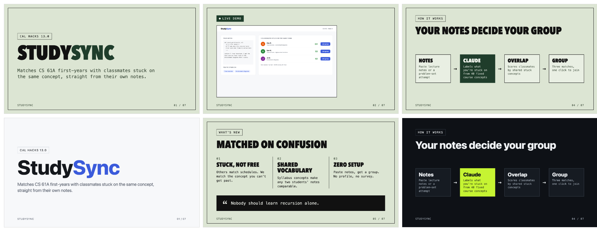

# calhacks-kit

Six Claude Code skills that take a hackathon team from idea to judged demo, plus a curated,
link-checked catalog of open-source repos worth using in a 36-hour build.

> **Unofficial.** Made by a Cal Hacks mentor for Cal Hacks 13.0 hackers. Not affiliated with or
> endorsed by Cal Hacks. When this kit and the organizers disagree, the organizers win.

## The skills

| Skill | When to run it | What you get |
|-------|----------------|--------------|
| `/hack-scope` | Hour 0-2 | The five problem questions, a deadline clock, one end-to-end journey, a cut list, and `HACK.md` |
| `/hack-stack` | Hour 1-3 | 3-5 picks from the [catalog](skills/hack-stack/catalog.yaml), the riskiest integration to spike, an architecture sketch |
| `/hack-check` | Every few hours | A score against the four judging criteria, scope-drift and honesty checks, rescue mode, feature freeze near the deadline |
| `/hack-ship` | Final hours | Secret scan, the pre-judging checklist verified with evidence, README and Devpost drafts |
| `/hack-pitch` | Before judging | A timed live-demo script, pitch roles, answers to likely judge questions |
| `/hack-showtime` | After the pitch is written | A short, themed HTML slide deck built around the live demo, checked for overflow, exported to PDF for Devpost |



*`/hack-showtime` output for StudySync, a fictional team from the [dry-run scenario](evals/studysync.md).
Open [`examples/studysync/deck.html`](examples/studysync/deck.html) locally, press F for fullscreen and N for notes.*

Every skill reads and writes **`HACK.md`** at the root of your project. It is the team's shared
plan: commit it, and every teammate's Claude session works from the same scope, stack, and clock.

## Install

**Claude Code (plugin)**

```
/plugin marketplace add georgeykalangi/calhacks-kit
/plugin install calhacks-kit@calhacks-kit
```

Plugin skills are namespaced, so they appear as `/calhacks-kit:hack-scope` and so on.
Claude also picks them up automatically when you describe what you need.

**Claude Code (plain skills, short names)**

```bash
git clone https://github.com/georgeykalangi/calhacks-kit
cp -r calhacks-kit/skills/* ~/.claude/skills/
```

**Cursor, Codex, and other agents** that support Agent Skills:

```bash
npx skills add georgeykalangi/calhacks-kit
```

**No coding agent? Use any chat (including free claude.ai).** Open a skill's `SKILL.md`, copy
everything below the `---` header, paste it into the chat, then describe your project. Each skill
has a "No file access?" section that tells the assistant how to work without your files.

## A 36-hour run

```
Hour 0   /hack-scope   -> HACK.md: user, problem, one journey, cut list
Hour 1   /hack-stack   -> stack picks, spike the riskiest integration
Hour 6   /hack-check   -> scores, drift, honesty
Hour 18  /hack-check   -> harden phase begins
Hour 24  /hack-check   -> feature freeze
Hour 30  /hack-ship    -> secret scan, checklist, README, submission draft
Hour 32  /hack-pitch   -> script, roles, Q&A
Hour 33  /hack-showtime -> deck.html + deck.pdf, then rehearse three times
```

## The rules still apply

Cal Hacks does not allow projects started before the event. This kit contains **no project
code**: only process, checklists, and links. Write your project during the event, and disclose
the open-source projects and AI tools you used in your submission.

AI can help you build faster, but your team must understand, review, and test what it writes.
Judges will ask.

## The catalog

[`skills/hack-stack/catalog.yaml`](skills/hack-stack/catalog.yaml) lists about 30 repos across
agent workflow, UI, app frameworks, backend, agents and data, voice, vision, code understanding,
and demo video. Each entry records when to use it, rough setup minutes, whether it needs an API
key, its license, and how much judges will see it.

Every link points to the original repo, not a fork. A weekly GitHub Action fails on repos that
disappear, get archived, or turn out to be forks, and warns on missing licenses and stale repos.
Review each repo's install steps, license, and permissions before you use it.

## Share what you build

- **Add a repo to the catalog**: see [CONTRIBUTING.md](CONTRIBUTING.md). Small PRs are welcome
  during the event.
- **Built something with the kit?** Add it to [SHOWCASE.md](SHOWCASE.md) after judging.
- **A skill gave bad advice?** [Open an issue](../../issues/new?template=bad-advice.md).

## Credits

Based on the *Cal Hacks 13.0: Build Something That Matters* hacker guide and the Cal Hacks
Winning Guide by [George Kalangi](https://github.com/georgeykalangi), Cal Hacks 12.0 mentor.
Catalog entries belong to their authors under their own licenses.

## License

[MIT](LICENSE)
